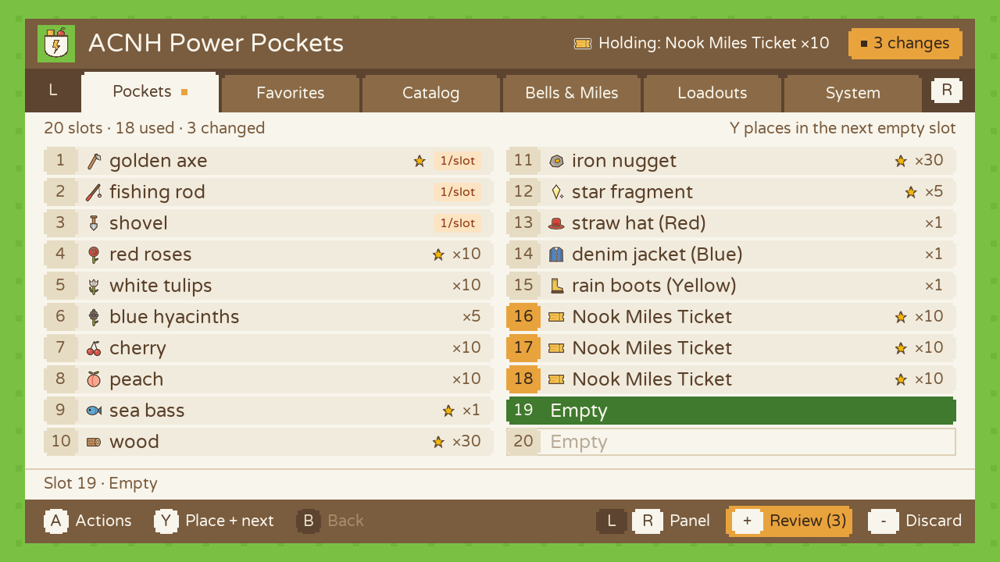
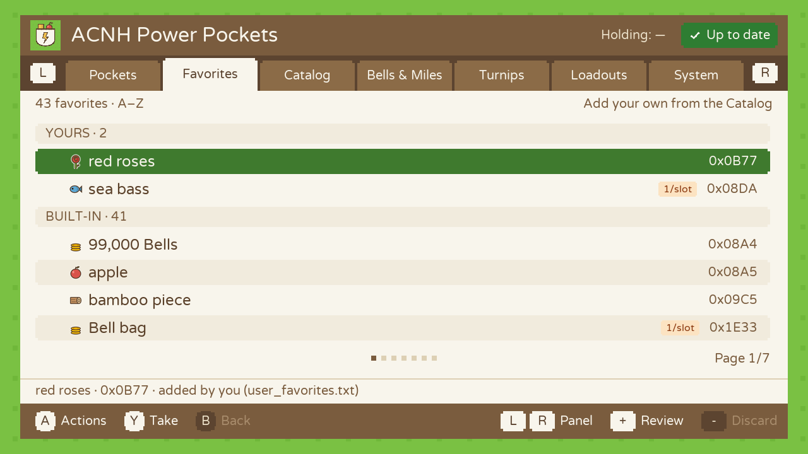
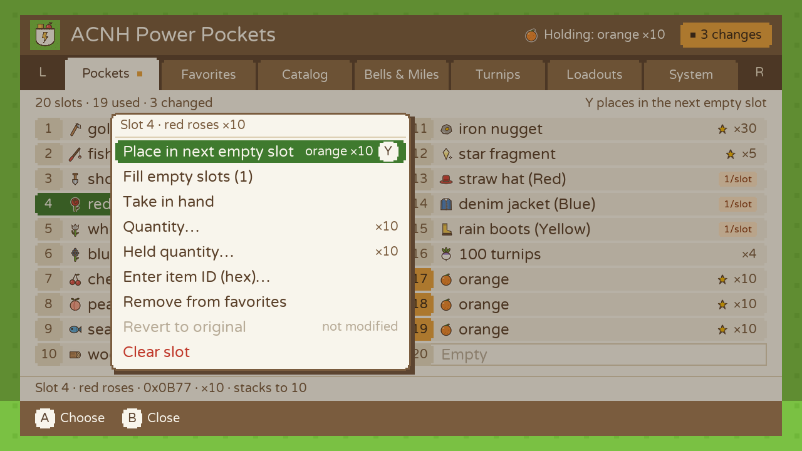
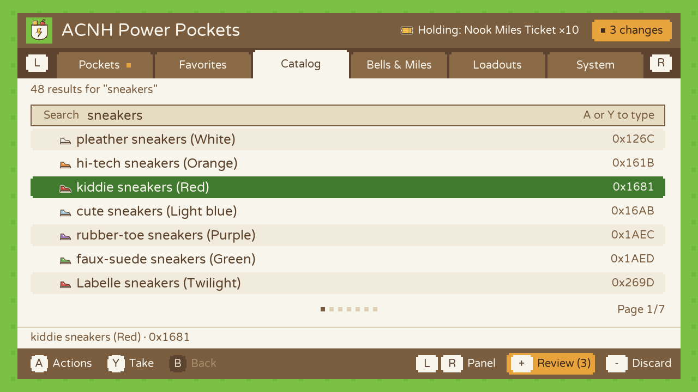
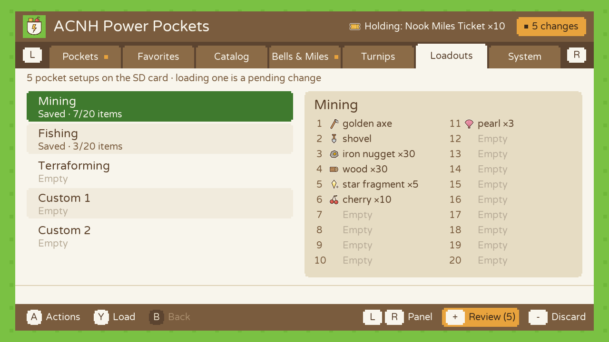
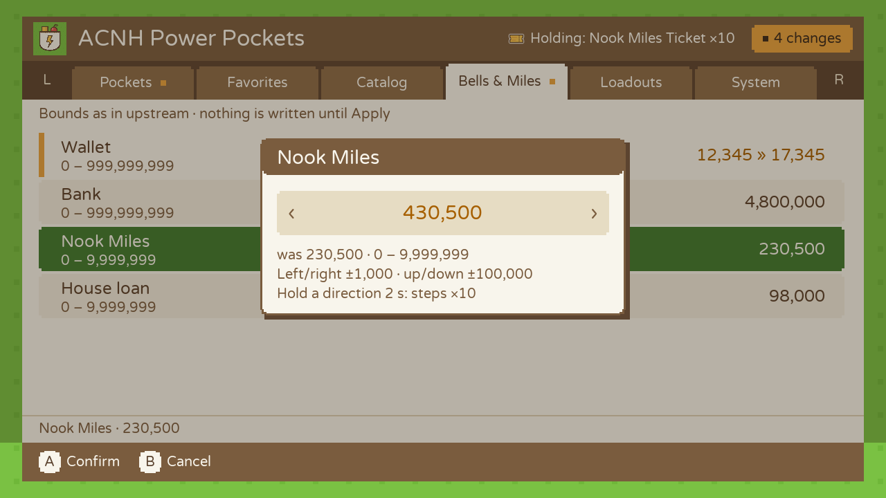
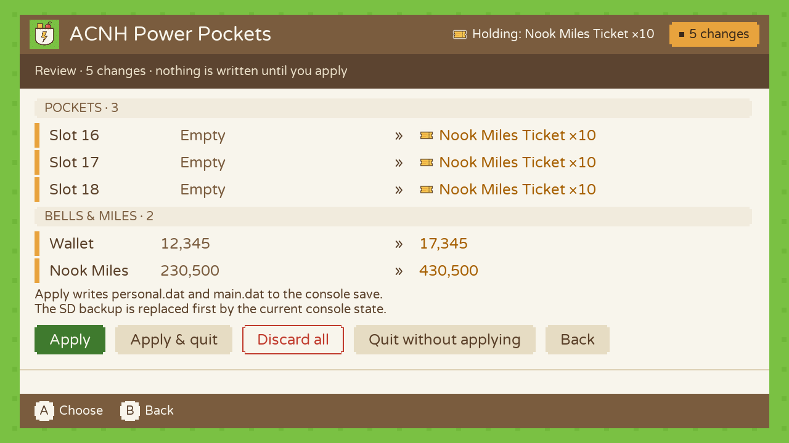
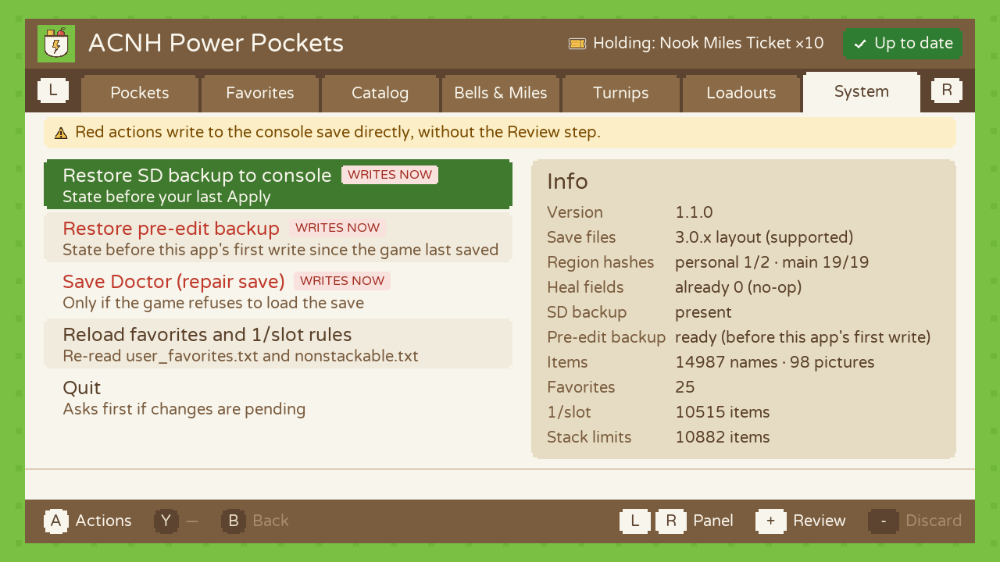
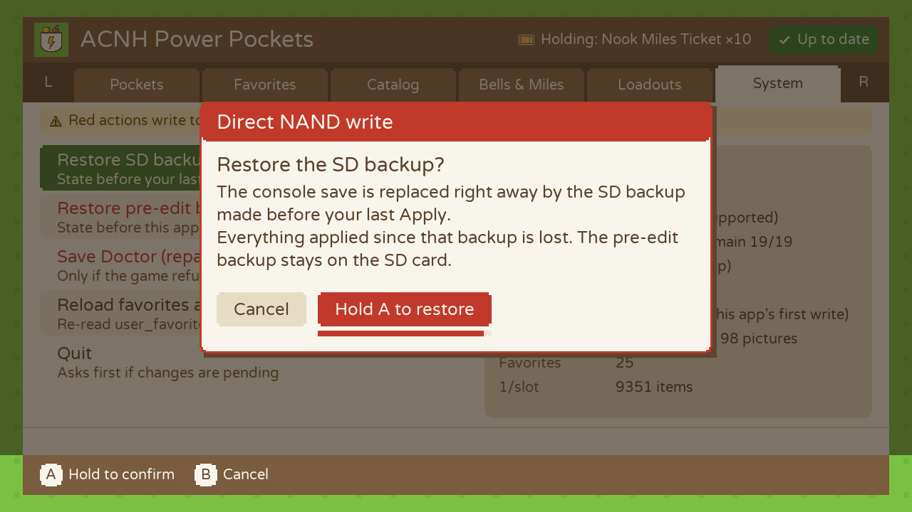

# ACNH Power Pockets

> [!CAUTION]
> **This tool writes directly to your Animal Crossing: New Horizons save. It can corrupt it, and a corrupted island may be impossible to recover.**
>
> - **Back up your save with [JKSV](https://github.com/J-D-K/JKSV) or [Checkpoint](https://github.com/BernardoGiordano/Checkpoint) before every editing session, and copy that backup to a computer.** The app's own SD backups are a safety net, not a replacement.
> - **Tested on one console and one save only (game 3.0.3).** The very first test was refused by the game as corrupted: one integrity hash had not been updated. Version 1.0.0 recomputes them, and its edits were then accepted by the game. That is a single island: do the [first-use test](#first-use-test) on a save you can afford to lose before touching yours.
> - Offline use only. Editing saves can get you into trouble online and may break Nintendo's terms of service. Never trade edited or unreleased items with other players.
> - Provided **as is, with no warranty of any kind** (MIT license). You alone are responsible for what happens to your save, your console and your accounts. Not affiliated with or endorsed by Nintendo.


**[Download a release](../../releases)** · Nintendo Switch with Atmosphère · Animal Crossing: New Horizons 3.0.x

**Fill your pockets fast, and see every change before a single byte is written.**

ACNH Power Pockets is a homebrew app for the Nintendo Switch (Atmosphère). It edits the 20 pocket slots, Bells, Nook Miles and the house loan of the primary resident, directly on the console.

It is a fork of [ACNH-Save-Editor](https://github.com/cbreezy210/ACNH-Save-Editor) by cbreezy210. The save engine is the upstream one: the only thing changed in it is the name of the SD folder where it keeps its backups. The interface is new, built around inventory work. See [Where it comes from](#where-it-comes-from).



## Contents

- [A quick tour](#a-quick-tour)
- [First-use test](#first-use-test)
- [Install](#install)
- [Using it](#using-it)
- [How your save is protected](#how-your-save-is-protected)
- [Known limitations](#known-limitations)
- [Files on the SD card](#files-on-the-sd-card)
- [Troubleshooting](#troubleshooting)
- [Building and testing](#building-and-testing)
- [Where it comes from](#where-it-comes-from)
- [Contributing](#contributing)
- [License and credits](#license-and-credits)

## A quick tour

Six panels, switched with **L** and **R**. **A** opens a menu of actions for whatever is selected. **Y** does the most common one directly.

### Ten slots in ten presses

Pick an item once, from your favorites, the catalog, or your own pockets. Each press of **Y** drops it in the next empty slot. Occupied slots are never overwritten: replacing an item takes an explicit *Clear slot* first.

| | |
|---|---|
|  |  |
| **Favorites.** Yours first, then the 22 built-in ones. Add or remove them from the app; they are saved on the SD card. | **One menu per slot.** Fill empty slots, change a quantity, pick the item up, favorite it, revert it, clear it. |

### A picture and a color for every item

98 small original pictures, one per kind of item, tinted with the item's color when its name gives one. Items that never stack (clothes, furniture, fish and bugs, recipes, tools… about 9,300 of them) carry a `1/slot` badge and are never given a quantity they can't hold. For those items the game uses the "quantity" field to pick a variant, so a wrong number there would give you a different item.

| | |
|---|---|
|  |  |
| **Catalog.** Search about 11,000 named items by name or by hex ID. | **Loadouts.** Five pocket setups saved on the SD card, with a preview. |

### Nothing is written until you apply

Every edit stays in memory and is marked in amber. **+** opens the Review: each change as *before » after*. **Apply** writes them all in one go, **Discard** drops them, and quitting asks first.

| | |
|---|---|
|  |  |
| **Bells & Miles.** Wallet, Bank, Nook Miles and House loan, by steps or typed in. | **Review.** The only way to the save goes through this screen. |

### Dangerous actions are hard to trigger

Restoring a backup and the Save Doctor write to the console right away. They live in the System panel, in red. They need **A** held for 1.5 seconds and are blocked while you have unapplied changes. The shoulder triggers do nothing.

| | |
|---|---|
|  |  |
| **System.** Backups, repair, and read-only diagnostics of the save. | **Hold to confirm.** Releasing early cancels. |

## First-use test

Do this once, with a save you can afford to lose. It answers two questions nobody has checked yet on this version: does the game accept a save written by this tool, and how does the game count stacks?

1. Back up the save with JKSV or Checkpoint and copy the backup to a computer.
2. Launch Power Pockets. Put **Nook Miles Ticket** in an **empty** slot with quantity **9** (*Favorites* › *Take with quantity…* › 9, then **Y** in *Pockets*). Press **+**, then **Apply**. Change nothing else. Use a real stackable item: "gold bars", for instance, is a piece of furniture (the stackable material is "gold nugget").
3. Start the game:
   - **The save doesn't load, or the game offers to restore it:** stop. Restore your JKSV/Checkpoint backup and [open an issue](../../issues) with your game version.
   - **You get 10 tickets:** the game stores "quantity − 1". Displayed quantities are off by one until `kCountZeroBased` is set to `true` in `source/pp_model.h`. Please report it.
   - **You get 9 tickets:** quantities are exact.
4. Save in the game, quit, reopen Power Pockets and look at **System › Info › Region hashes**. It should read `personal 2/2 · main 19/19`. Report it if it doesn't.

## Install

Requirements: a Switch running Atmosphère, and Animal Crossing: New Horizons **3.0.x** (other save versions open read-only).

1. Download `ACNH-Power-Pockets-v1.0.0.zip` from the [Releases page](../../releases) (v1.0.0 is marked pre-release) and extract it to the root of the SD card. It creates `switch/acnh_power_pockets/`. Builds of every commit are also in the [Actions tab](../../actions) (GitHub login required).
2. Fully close the game: HOME › highlight Animal Crossing › **X** › Close. A suspended game overwrites your edits on its next autosave.
3. Hold **R** while starting Animal Crossing to open the Homebrew Menu, then launch **ACNH Power Pockets**. Launching from the Album is refused: it doesn't give the app enough access.

The folder should contain:

| File | Needed? |
|---|---|
| `acnh_power_pockets.nro`, `font.ttf` | Required |
| `items.txt` | Strongly recommended: item names, favorites and the `1/slot` protection depend on it |
| `item_glyphs.png`, `item_glyphs.txt` | Strongly recommended: item pictures, and the kinds of items that never stack (without them, the `1/slot` protection only covers tools and the few items listed in `nonstackable.txt`) |
| `icon.png`, `ui_icons.png`, `nonstackable.txt` | Optional: icons, extra `1/slot` rules |

### Already using ACNH-Save-Editor?

Power Pockets has its own file name and its own folder (`switch/acnh_power_pockets/acnh_power_pockets.nro`). Nothing is replaced and nothing is shared: its backups, loadouts and settings are separate from those of upstream, which stays in `switch/acnh_editor/`. A `.nro` has no application ID, so the two can't clash on the console.

- To bring your loadouts over, copy `l_0.dat` … `l_4.dat` from `switch/acnh_editor/` into `switch/acnh_power_pockets/`.
- Don't copy `backup_*.dat`: Power Pockets only restores backups that match the current save, and makes its own.
- Both apps edit the same save. Use one at a time, and remember that upstream writes on a single press of **A**.

## Using it

### Buttons

| Button | Does |
|---|---|
| **L / R** | Switch panel |
| **D-pad / left stick** | Move (hold to repeat) |
| **A** | Open the action menu for the selected thing |
| **Y** | Its default action (the first line of that menu) |
| **B** | Close a menu, dialog or number editor |
| **+** | Review pending changes, then Apply / Discard / Quit |
| **−** | Discard all pending changes |
| **ZL, ZR, X** | Nothing, on purpose |

### Panels

| Panel | For |
|---|---|
| **Pockets** | The 20 slots. **Y** places the item in hand in the next empty slot, or picks up the item under the cursor when your hand is empty. Menu: *Fill empty slots*, *Take in hand*, *Quantity…*, *Held quantity…*, *Enter item ID (hex)…*, *Add/Remove favorite*, *Revert to original*, *Clear slot*. |
| **Favorites** | Two groups, each A to Z: **YOURS**, then **BUILT-IN**. **Y** takes one and jumps back to Pockets. A built-in favorite can be hidden, and comes back with *Restore default favorites*. |
| **Catalog** | Search by name or 4-digit hex ID. ★ marks your favorites. |
| **Bells & Miles** | Wallet, Bank, Nook Miles, House loan. Step with the D-pad (±1,000 / ±100,000, ×10 after holding 2 s) or type a value. A warning shows above the game's wallet limit (99,999). |
| **Loadouts** | Five saved pocket setups. Loading one is a pending change like any other. |
| **System** | Restore backups, Save Doctor, reload your lists, diagnostics, quit. |

### Recipes

- **Ten stacks of Nook Miles Tickets:** **R** › *Nook Miles Ticket* › **A** › *Take with quantity…* › 10 › **A**, then **Y** ×10, then **+** › **Apply**.
- **Copy something you already carry:** in *Pockets*, select it and press **Y** with an empty hand to pick it up, then **Y** again to place copies.
- **Fill every free slot:** take an item, then **A** › *Fill empty slots*.
- **Undo one slot:** **A** › *Revert to original*. **Undo everything:** **−**.
- **Add a favorite:** find the item in *Catalog* › **A** › *Add to favorites*.

## How your save is protected

**Every Apply:**
1. Before its first write, copies the console's current save to `session_*.dat` on the SD card: the **pre-edit backup**. It is kept, across relaunches too, for as long as the console still holds what the app wrote last. Once the game has saved again, the next Apply takes a fresh one. So it always holds the last state written by the game itself.
2. Recomputes the save's 21 integrity hashes in memory and checks them all. If one doesn't match, nothing is written.
3. Hands your changes to the upstream engine. The engine first writes `backup_*.dat` (the state before this Apply), then writes and commits the save.
4. Reloads the "original" state only if every step succeeded. If anything fails, your changes stay pending and the app says what happened.

**Before any restore**, the backup is checked on a decrypted copy: sizes and value checksums must match, and it may only differ from the current save where this app writes (pockets, the four values, eight repair fields). Otherwise the restore is refused. A backup that is incomplete, damaged, or older than the game's last save is never offered.

**The app's backups are not full backups.** They hold `personal.dat` and `main.dat` only, without the key files. They can't be restored with another tool, and they stop being usable as soon as the game saves again.

**What this does *not* protect you from:** a game version with a different save layout (the app goes read-only when file sizes are unexpected, but that check is not exhaustive), power loss at the wrong moment, or SD card failure. That is why the JKSV/Checkpoint backup at the top of this page matters.

## Known limitations

- **Not confirmed in the game yet.** The game protects each region of the save with a hash and refuses the whole save when one is stale. Power Pockets now recomputes all 21 before writing (upstream's unreleased source, which this fork started from, had stopped doing it). This is verified on real dumps, not yet by the game itself. System › Info shows how many hashes match.
- **Quantity convention unconfirmed:** see the [first-use test](#first-use-test).
- **Slow start on a save with a stale hash.** If a save was written without its hashes (by an earlier build of this app, for instance), the inherited engine rescans the files at launch. The "Reading the save…" screen can then stay up for tens of seconds, or minutes (estimates, not measured on a console). It is not frozen: wait, then run the Save Doctor.
- **Only the primary resident** (`Villager0`) and **only the 20 pocket slots** (not the bag expansion).
- **Save versions 3.0.x only**; anything else is read-only.
- Item names are English, from `items.txt`. About 6 % of the named items have no picture rule yet and show a "?".

## Files on the SD card

All in `sdmc:/switch/acnh_power_pockets/`.

| File | Written by | What it is |
|---|---|---|
| `user_favorites.txt` | the app | Your favorites. Plain text, safe to edit. `.bak` keeps your previous version. |
| `nonstackable.txt` | you | Extra `1/slot` rules (optional) |
| `item_glyphs.png`, `item_glyphs.txt` | you (install) | Item pictures, the rules that pick a picture and a color for each item, and which kinds of items never stack |
| `backup_personal.dat`, `backup_main.dat` | the app | Save as it was before the last Apply |
| `session_personal.dat`, `session_main.dat` | the app | Pre-edit backup: save as the game last wrote it, before this app's first write |
| `session_mark.txt` | the app | Tells the app whether the pre-edit backup still matches the console (don't edit) |
| `damaged_*.dat` | Save Doctor | Copy taken before a repair |
| `l_0.dat` … `l_4.dat` | the app | Loadouts |
| `layout_*.dat` | the app | Cache of the save's region layout |

`user_favorites.txt` format:
```text
+16DB Nook Miles Ticket     a favorite you added (the hex ID counts, the name is a reminder)
-0A4E gold roses            a built-in favorite you hid
```

`nonstackable.txt` format (rules apply top to bottom):
```text
golden axe     exact item name, case-insensitive
0x0A1B         item ID
~wand          every item whose name contains "wand"
-Wandering     undo a match
```
Tools (axes, nets, fishing rods, shovels, watering cans, slingshots, ladder, vaulting pole) are always `1/slot`. Whole kinds of items (clothes, furniture, fish, recipes…) are `1/slot` through `item_glyphs.txt`. The shipped `nonstackable.txt` adds wands, saplings and sprouts, and its rules apply last, so it can also take an item off the list.

`item_glyphs.txt` documents its own format at the top of the file. A mistake in it only changes the pictures and which items are treated as `1/slot`.

## Troubleshooting

| Symptom | Fix |
|---|---|
| "The save can't be opened" | The game is still running or suspended. Close it fully (HOME › X › Close), then relaunch through the game holding **R**. |
| Red "missing file" or "unreadable file" text at launch | `font.ttf` is missing from `sdmc:/switch/acnh_power_pockets/`, or its copy is damaged. |
| Names show as `ID 16DB` | `items.txt` is missing. Editing still works, but favorites become read-only and the `1/slot` protection is off: put the file back before placing items. |
| No pictures next to the items | `item_glyphs.png` or `item_glyphs.txt` is missing. System › Info says "no pictures". Put them back: without them the `1/slot` protection only covers tools. |
| The game says the save data is corrupted | Restore your JKSV/Checkpoint backup. Or, in Power Pockets: System › *Restore pre-edit backup* (the state before your edits), or System › *Save Doctor* (keeps your edits and recomputes the hashes). Then please [open an issue](../../issues). |
| Amber banner "Stale integrity hash" | The save on the console has a hash that doesn't match its data, and the game would refuse it. System › *Save Doctor* fixes it; so does any Apply. |
| Stuck on "Reading the save…" | Not frozen. With a stale hash on the console the launch scan is slow (up to minutes). |
| "This backup doesn't belong to the current save" | The game has saved since the backup was made, or the file is damaged. It can't be restored; use your JKSV/Checkpoint backup. |
| "Read-only: unsupported save version" | Your save isn't the 3.0.x layout this engine knows. Nothing will be written. |
| Changes vanished in the game | The game was suspended while you edited, or you quit without **Apply**. |
| Restore is blocked | Apply or discard your pending changes first, or the last backup wasn't written completely (System › Info). |

## Building and testing

You need devkitPro with `switch-dev`, `switch-sdl2` and `switch-sdl2_ttf`. Then run:
```sh
make
```
Each push builds the `.nro` in GitHub Actions (`devkitpro/devkita64` container) and uploads the SD-card folder as an artifact.

You can check the project without a Switch:
```sh
git remote add upstream https://github.com/cbreezy210/ACNH-Save-Editor.git && git fetch upstream
python3 tools/check_engine_untouched.py upstream/main   # proves the save engine matches upstream, SD folder name aside
sh tests/host/run.sh            # unit tests, parser fuzzing, item-picture rules vs the design tool, compile check
sh tests/host/engine_bench.sh   # the real main.cpp on a fake console: byte-exact Apply / restore / Doctor, injected failures
PP_REAL_SAVE=<unzipped JKSV backup> sh tests/host/engine_bench.sh real_save   # same checks on a dump of your own save
sh tests/host/ui_shots.sh       # the real UI with a fake engine: flows and failure dialogs, with screenshots
sh tests/host/ui_gallery.sh     # regenerates the screenshots of this README
```
The two `ui_*` scripts need SDL2 and SDL2_ttf (`brew install sdl2 sdl2_ttf`) and Python Pillow. Pillow also enables the item-picture check in `run.sh`.

| Path | Contents |
|---|---|
| `source/main.cpp` | Upstream save engine and the wiring to the UI |
| `source/pp_model.*` | Testable logic: slots, pending changes, favorites, `1/slot` and picture rules, backup checks |
| `source/pp_ui.*`, `source/pp_strings.h` | Panels, dialogs, every on-screen string |
| `tools/` | Engine check, and the scripts that draw the logo, icons and item pictures |
| `docs/design/` | Visual design system, item pictures, HTML mockups |
| `docs/ux/UX_SPEC.md` | Interaction spec |
| `docs/engine/AUDIT_ECRITURE.md` | Read-only audit of the save-writing code |
| `docs/review/BUG_HUNT.md` | Pre-console bug hunt: findings, fixes, remaining risks |

The documents in `docs/` are written in French.

## Where it comes from

Power Pockets starts from [ACNH-Save-Editor](https://github.com/cbreezy210/ACNH-Save-Editor) v1.4.1 (commit `731c228`) by cbreezy210, a native Switch save editor for Animal Crossing. Everything that reads, decrypts, encrypts and writes the save is upstream code. One thing was changed in it: the SD folder in the paths of its own files (`backup_*.dat`, `damaged_*.dat`, `layout_*.dat`), so that Power Pockets and upstream never share a file. A script checks on every push that this is the only difference, down to the byte.

One step was added around the engine, not inside it: just before each write, Power Pockets recomputes the save's integrity hashes in memory. The engine then writes those bytes as they are.

What changed is everything you see and touch:

| ACNH-Save-Editor | ACNH Power Pockets |
|---|---|
| **A** saves to the console immediately | Changes are prepared, reviewed, then applied together |
| One slot per save | Any number of slots per Apply, **Y** fills the next empty slot |
| Favorites compiled into the app | Favorites editable in the app, stored on the SD card |
| Item names only | A picture and a color for each item |
| Quantity asked for every item | `1/slot` items flagged, no quantity asked |
| **ZL** restores in one press, **ZR ZR** runs the Doctor | Both in the System panel, hold-to-confirm, blocked with pending changes |
| One rolling backup | Rolling backup plus a pre-edit backup kept until the game saves, both validated before restoring |
| Integrity hashes: rewritten for regions guessed by scanning (v1.4.0 release), not rewritten at all (later, unreleased source) | Rewritten from the fixed 3.0.x region table, and all 21 checked before anything is written |

The logo, icons and item pictures are original drawings made for this project. They are not taken from the game.

Upstream's own history and plans: [ROADMAP.md](ROADMAP.md) (kept unchanged).

## Contributing

The most useful contribution right now is a **first-use test report**. Open an issue with your game version, your firmware/Atmosphère version, how many tickets you got, and what System › Info showed.

Pull requests are welcome for the interface, tests and docs. Changes to the save engine (`source/main.cpp` engine blocks) need a strong case and a way to test them. `tools/check_engine_untouched.py` fails on purpose when the engine changes.

## License and credits

MIT. See [LICENSE](LICENSE). Copyright cbreezy210 (upstream) and the Power Pockets contributors.

Two shipped data files keep their own license (details in [THIRD_PARTY_NOTICES.md](THIRD_PARTY_NOTICES.md), texts in [`licenses/`](licenses)): `items.txt`, the item names table from NHSE (GPL-3.0), and `font.ttf`, the Varela Round font (SIL OFL 1.1).

- **cbreezy210** — [ACNH-Save-Editor](https://github.com/cbreezy210/ACNH-Save-Editor), the save engine this project runs on.
- **kwsch and [NHSE](https://github.com/kwsch/NHSE)** — the ACNH save-format research everything here relies on, and the item names table (`items.txt`, GPL-3.0).
- **[devkitPro](https://devkitpro.org) / libnx**, **SDL2**, **SDL_ttf**, **stb_image**.
- **Varela Round** font by The Varela Round Project Authors (SIL Open Font License 1.1).
